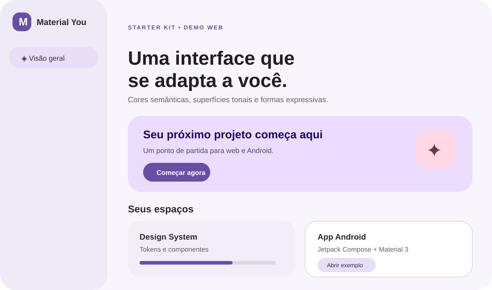
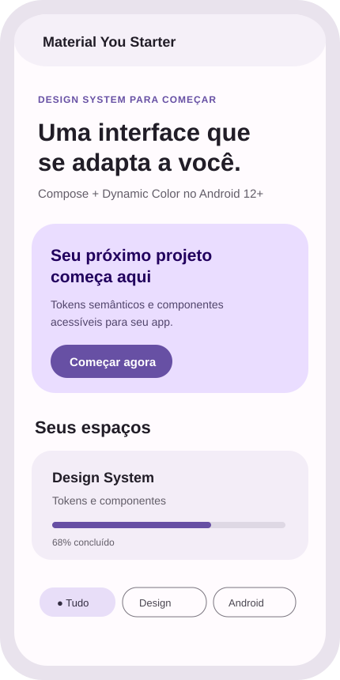

# Material You Starter Kit

Kit open source para começar interfaces inspiradas no **Material 3 (M3)** e no **Material 3 Expressive** da Google, com exemplos para sites e apps Android nativos.

> Material 3 Expressive é uma evolução do Material 3, não uma nova versão separada. Este repositório é um starter independente e **não é afiliado, mantido ou endossado pela Google**. Ele demonstra princípios e componentes; não redistribui o sistema proprietário de apps Google.

<p align="center"></p>
<p align="center"></p>

## O que vem incluído

- **Demo web funcional** sem etapa de build: tema claro/escuro, troca de cor de destaque, cartões, chips, botões e navegação responsiva.
- **Tokens compartilháveis** em CSS custom properties para cor, tipografia, forma e elevação.
- **Exemplo Android em Kotlin + Jetpack Compose Material 3** com tema claro/escuro, Dynamic Color no Android 12+ e fallback em versões anteriores.
- **Referências e guia em português** para adaptar ao seu produto sem copiar marcas ou telas do Google.
- **GitHub Pages**: o workflow publica automaticamente a demo quando o Pages é habilitado no repositório.

## Ver a demo localmente

Abra `web/index.html` no navegador. Para servir localmente, na pasta do projeto:

```bash
python3 -m http.server 8000 -d web
```

Acesse `http://localhost:8000`.

## Usar no seu site

1. Copie `web/tokens.css` e `web/material-you.css` para seu projeto.
2. Inclua os estilos no `<head>`:

```html
<link rel="stylesheet" href="tokens.css">
<link rel="stylesheet" href="material-you.css">
```

3. Aplique os tokens semânticos em vez de fixar cores em cada componente:

```css
.meu-botao {
  color: var(--md-sys-color-on-primary);
  background: var(--md-sys-color-primary);
  border-radius: var(--md-sys-shape-corner-full);
  padding: 0.75rem 1.25rem;
}
```

Os nomes seguem o padrão de papéis semânticos do Material. O exemplo define temas claro/escuro e reage à preferência do sistema; a demo também oferece controles para testar as cores.

## Usar no Android

Abra a pasta `android/` no Android Studio. O app de exemplo usa Jetpack Compose e a biblioteca oficial `androidx.compose.material3`. Consulte [android/README.md](android/README.md) para requisitos e instruções.

- Em Android 12/API 31+, `dynamicColor = true` usa a paleta do sistema baseada no papel de parede.
- Em versões anteriores, ou se desativado, usa uma paleta de fallback incluída no exemplo.
- Os componentes Compose usam os papéis de `MaterialTheme.colorScheme`.

## Personalização e acessibilidade

- Mude a cor semente nas variáveis CSS ou no controle de cor da demo.
- Use sempre pares de papéis compatíveis (`primary`/`onPrimary`, `surface`/`onSurface`).
- Verifique contraste, foco por teclado, leitores de tela e tamanhos de toque no seu contexto real. Tokens não substituem testes de acessibilidade.
- Não aplique cores dinâmicas de fundo a fundos fotográficos sem avaliar legibilidade.

## Referências oficiais

- [Material Design 3](https://m3.material.io/)
- [Introdução ao Material 3 Expressive](https://m3.material.io/blog/building-with-m3-expressive)
- [Material 3 no Jetpack Compose](https://developer.android.com/develop/ui/compose/designsystems/material3)
- [Material Web](https://material-web.dev/) — a documentação informa que a biblioteca está em modo de manutenção; por isso a demo web deste kit usa CSS próprio e não depende dela.
- [Material Theme Builder](https://material.io/material-theme-builder)

**Inspiração visual:** use as diretrizes e componentes descritos pela Google; as imagens acima são mockups originais deste projeto, não capturas de Gmail, Fotos ou outros produtos Google.

## Licença

MIT. Veja [LICENSE](LICENSE). As marcas e materiais vinculados da Google pertencem aos respectivos titulares.
