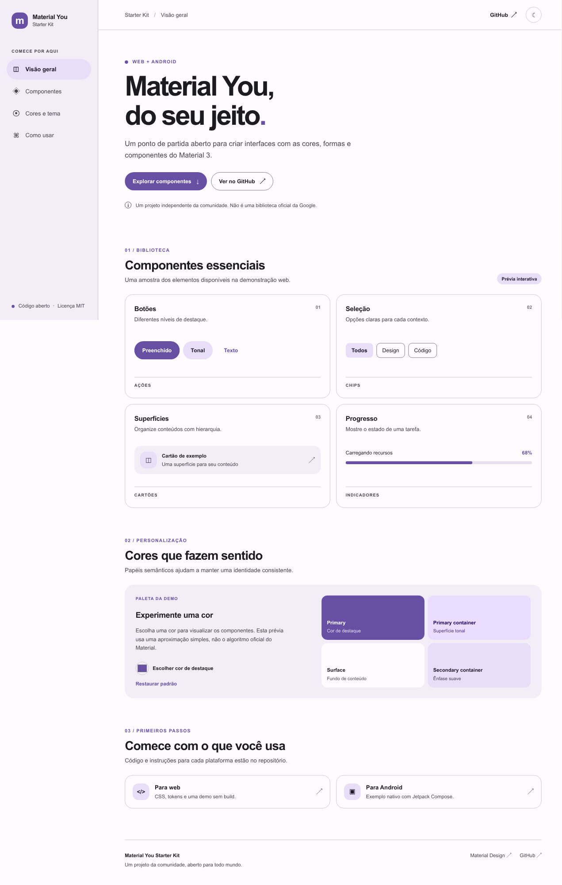

<p align="center"></p>

# m3 kit · 1.0.0

Material 3 para web e Android, com uma identidade própria. Código aberto, licença MIT. O pacote completo também é open source: não existe edição paga ou proprietária escondida.

[Demo web](https://in3zalo-gk.github.io/material-you-starter-kit/) · [Downloads](https://github.com/in3zalo-gk/material-you-starter-kit/releases/latest) · [Exemplo web](https://in3zalo-gk.github.io/material-you-starter-kit/examples/minimal.html)



## Incluído

- Web: laboratório de cores com Material Color Utilities, tema claro/escuro, imagem processada localmente, exportação de tokens CSS, abas por teclado, diálogo com validação e três idiomas.
- Android: Compose Material 3 1.4.0, tema sistema/claro/escuro e Dynamic Color persistentes, fallback verde, controles, diálogo, snackbar e idiomas pt/en/es.
- Exemplos mínimos independentes: HTML em `web/examples/minimal.html` e app nativo em `android/example`.
- Logo vetorial, arquivos-fonte, documentação e builds web prontos para hospedar.

## Downloads

A release reúne código-fonte completo MIT, fontes por plataforma, exemplos, site compilado e dois APKs **debug assinados com chave de desenvolvimento**. São apps demonstrativos para instalação manual, não binários de produção/Play Store. Preserve sua própria chave de produção fora deste repositório.

Veja [qual pacote baixar](docs/DOWNLOADS.md). Os arquivos `SHA256SUMS.txt` permitem conferir integridade. Releases são publicadas apenas depois de build web, testes de navegador, auditoria de dependências, build Android e lint passarem.

## Web local

Requer Node 20.19+ ou 22.12+ e npm.

```sh
cd web
npm ci
npm run dev
# produção: npm run build
```

`web/dist/` pode ser servido por qualquer hospedagem estática. Abra o exemplo mínimo em `/examples/minimal.html`; não abra arquivos de desenvolvimento via `file://`.

## Android local

JDK 17, SDK 36 e Gradle 8.13. Abra `android/` no Android Studio ou execute:

```sh
gradle -p android assembleDebug lintDebug
```

[Guia Android](android/README.md) · [Exemplos](docs/EXAMPLES.md) · [Componentes e limites](docs/COMPONENTES.md) · [Idiomas](docs/IDIOMAS.md) · [Changelog](CHANGELOG.md)

## Escopo estável

1.0.0 estabiliza este **starter demonstrativo**, não todo o catálogo Material 3 nem um backend. Sem login, pagamentos, serviços remotos ou garantias de conformidade automática. Testes automatizados não substituem testes reais com TalkBack, dispositivos e seu conteúdo.

Projeto independente, sem afiliação ou endosso da Google. Web usa CSS próprio e a biblioteca oficial Material Color Utilities; Android usa Compose Material 3. Algumas APIs de UI do Android exigem opt-in experimental, apesar de a dependência Material3 ser estável.

## Referências

[Material 3](https://m3.material.io/) · [Compose Material3](https://developer.android.com/develop/ui/compose/designsystems/material3) · [Material Color Utilities](https://github.com/material-foundation/material-color-utilities)

MIT © 2026 SayNoob_TYT. Veja [LICENSE](LICENSE). Marcas de terceiros pertencem aos seus titulares.
